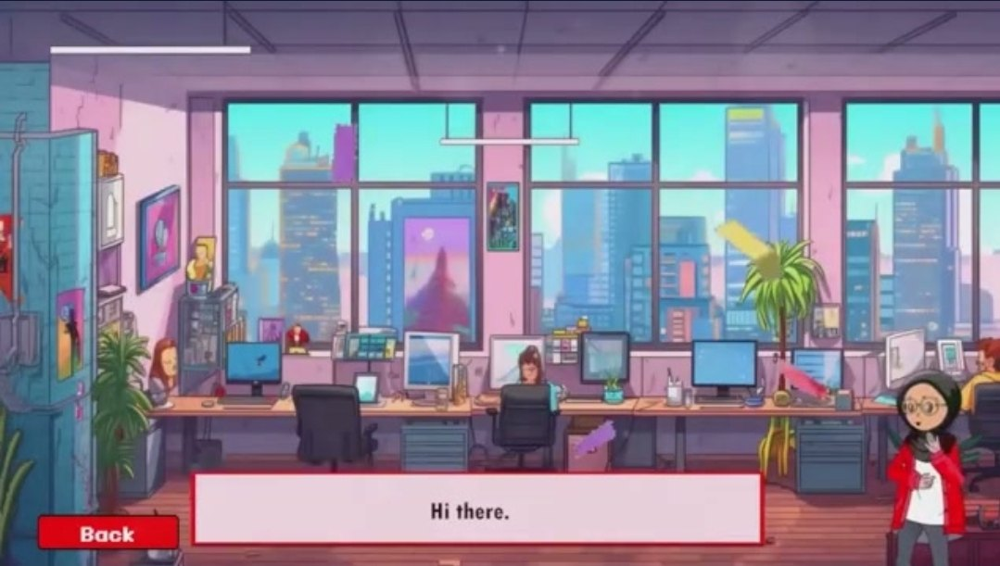
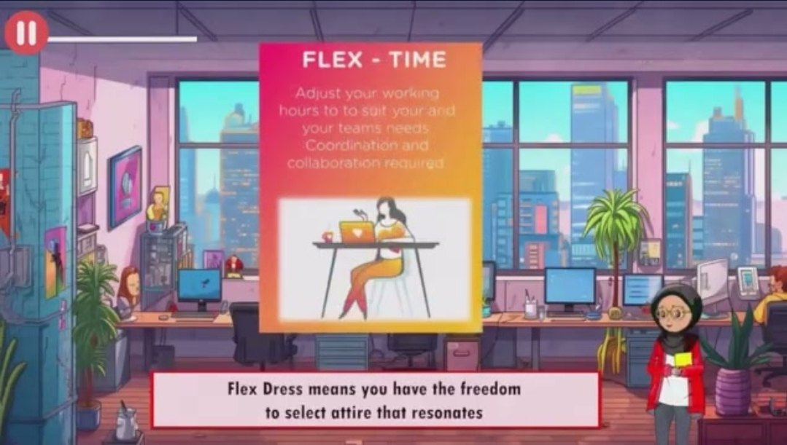
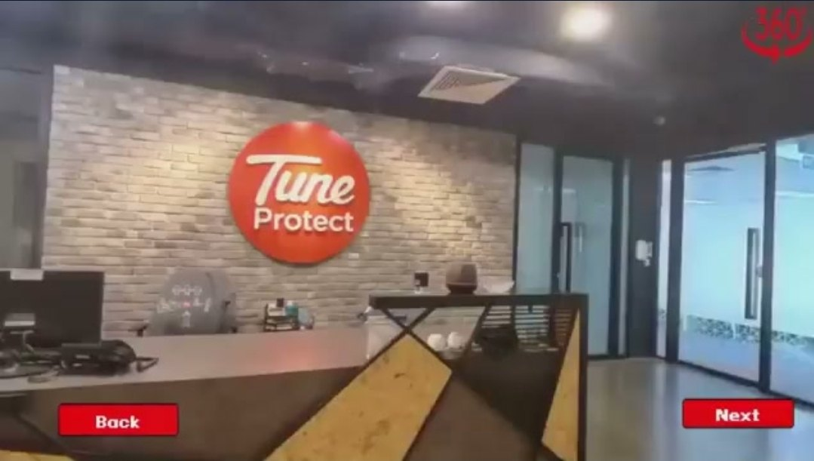
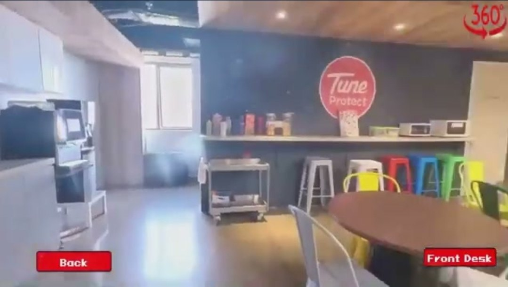
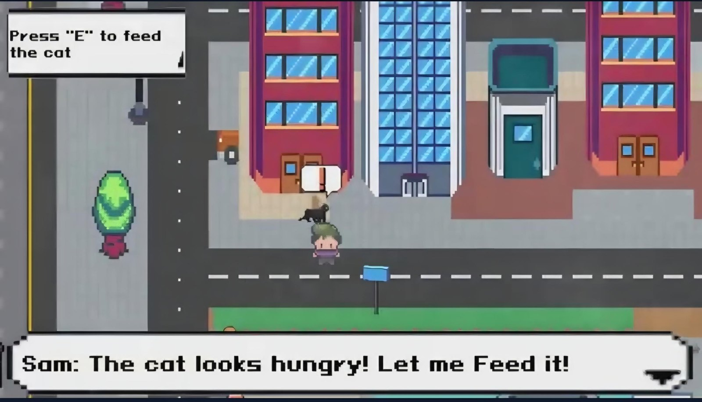
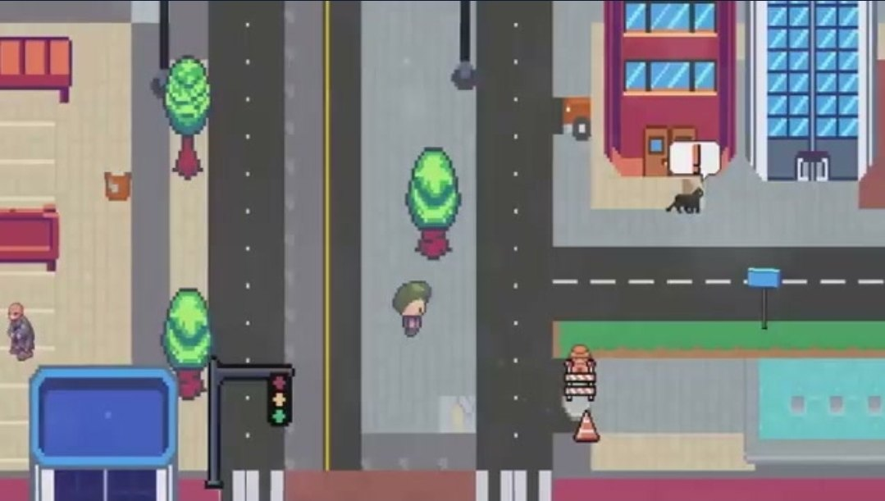
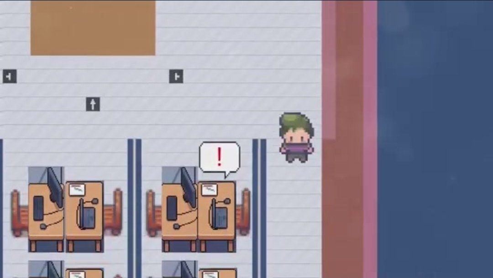

# Tune Protect Onboarding App

> An interactive Windows onboarding experience developed in Unity, combining company orientation with gamified activities and mini-games.

**Role:** Main Developer · **Client:** Tune Protect Group (delivered via APU) · **Period:** Aug 2023 – Mar 2024 · **Engine:** Unity · **Platform:** Windows PC

▶ **[Watch the gameplay video on YouTube](https://youtu.be/PAylIqWb4oU)** · 🌐 [Portfolio case study](https://mthportfolio.chronocraftstudios.com/tune-protect.html)

## My Role

I was the main developer responsible for the application, including its mini-games, visual effects and interactive flow:

- Assembled **about 30–35 animated onboarding scenes** in **Unity Timeline**, combining 2D character animation, backgrounds, narration and sound.
- Integrated **standard and 360-degree video** content, including a 360° tour of the Tune Protect office.
- Built the mini-games: an office-themed object-slicing game, a basket-catching game, and two top-down pixel-art games (community-help tasks such as feeding a cat and fixing a leak, and an office computer-virus challenge).

## Gameplay

<table>
  <tr>
    <td width="50%" align="center"><br><sub><b>Animated onboarding</b>: guide character introducing new employees.</sub></td>
    <td width="50%" align="center"><br><sub><b>Policy topics</b>: workplace information delivered through animated cards.</sub></td>
  </tr>
  <tr>
    <td width="50%" align="center"><br><sub><b>360° office tour</b>: front desk, with Back/Next navigation.</sub></td>
    <td width="50%" align="center"><br><sub><b>360° office tour</b>: pantry area.</sub></td>
  </tr>
  <tr>
    <td width="50%" align="center"><br><sub><b>Community-help game</b>: top-down pixel-art tasks with interaction prompts.</sub></td>
    <td width="50%" align="center"><br><sub><b>Pixel-art city</b>: exploring the map to find tasks.</sub></td>
  </tr>
  <tr>
    <td width="50%" align="center"><br><sub><b>Office virus challenge</b>: finding infected computers in the office.</sub></td>
    <td width="50%"></td>
  </tr>
</table>

## Overview

The **Tune Protect Onboarding App** was created to make employee onboarding more engaging and interactive. Rather than presenting company information only through conventional documents or presentations, the application guides new employees through a digital onboarding experience that combines company-focused content with interactive activities.

The experience introduces users to the Tune Protect environment while using game-inspired interactions to encourage exploration, participation, and engagement throughout the onboarding journey.

## Project Context

- **Type:** Employee Onboarding Application
- **Platform:** Windows
- **Engine:** Unity 2023.1.19f1
- **Rendering:** Universal Render Pipeline (URP)
- **Language:** C#
- **Focus:** Interactive onboarding, gamification, mini-games, UI and employee engagement

## Interactive Experience

The application combines onboarding content with multiple interactive activities. The repository contains systems for experiences including:

- **Office Ninja** — object spawning, blade interaction, hazards and game-state management
- **Black Cups** — an interactive mini-game activity
- **Sky Catch** — an additional gameplay-based onboarding activity
- **Clean Desk** — an interaction focused around organising/clearing the workspace
- **Word Search** — a custom word-search system used as an interactive activity
- **Matching Activities** — item-matching logic and interaction handling
- **Menu & Navigation Systems** — supporting movement between activities and application states

These activities sit inside the larger onboarding application rather than functioning as separate standalone games.

## Technical Systems

The project includes a range of custom Unity/C# systems for managing the interactive experience:

- Mini-game and activity state management
- Object spawning and gameplay event handling
- Collision and interaction logic
- Matching mechanics
- Word-search generation and interaction
- UI and menu navigation
- Animation and particle-system integration
- Video and multimedia support
- Scene-based onboarding flow

## Technology Stack

The repository's Unity project files confirm the following core stack:

| Technology | Use |
|---|---|
| **Unity 2023.1.19f1** | Application development |
| **C#** | Interaction, activity and application logic |
| **URP 15.0.7** | Rendering pipeline |
| **TextMeshPro 3.0.6** | Interface and text presentation |
| **Timeline 1.8.6** | Sequenced content and presentation |
| **Unity UI (UGUI)** | Application interface |
| **Visual Scripting 1.8.0** | Supporting Unity workflows |
| **Unity Animation / Physics / Particle / Video modules** | Interactive and multimedia systems |

## Trailer

The project trailer demonstrates the onboarding experience, company-oriented content, interactive activities, mini-games and workplace context.

**[Watch the Tune Protect Onboarding App Trailer](https://drive.google.com/file/d/1h-n-DgwhZmtdsN237b6Vdf5HR5sK1wQ5/view)**

## Repository Structure

```text
TuneProtectOnboarding/
├── Scripts/
│   ├── Core/                 # Menu and navigation (GameMenu)
│   ├── Activities/           # Clean Desk, Word Search, matching, letters
│   └── MiniGames/
│       ├── OfficeNinja/      # Object-slicing game: blade, spawner, bombs, game state
│       ├── SkyCatch/         # Basket-catching game: player, spawner, UI
│       └── BlackCups/        # Cup mini-game
├── Media/Gameplay/           # Screenshots
├── Packages/manifest.json
├── ProjectSettings/ProjectVersion.txt
└── README.md
```

> **Note:** This repository is a portfolio/technical showcase of selected scripts, not a complete distributable build. Scenes, art and video assets are client-owned.

---

### About the Project

The Tune Protect Onboarding App demonstrates how **Unity and game-development techniques can be applied beyond traditional games** to create interactive corporate experiences. By combining onboarding information with gamified activities, the project explores a more participatory approach to introducing employees to an organisation and its workplace experience.